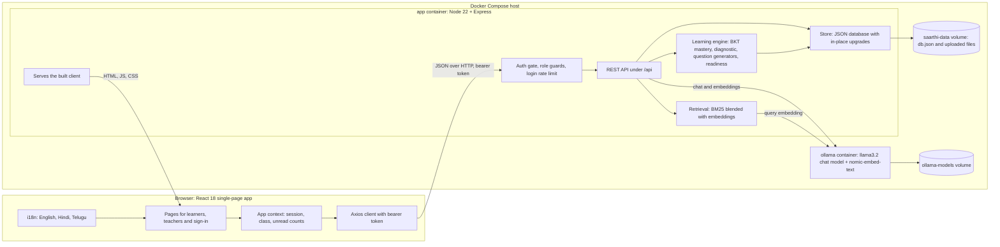
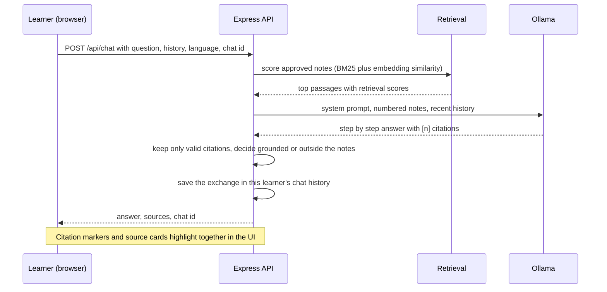
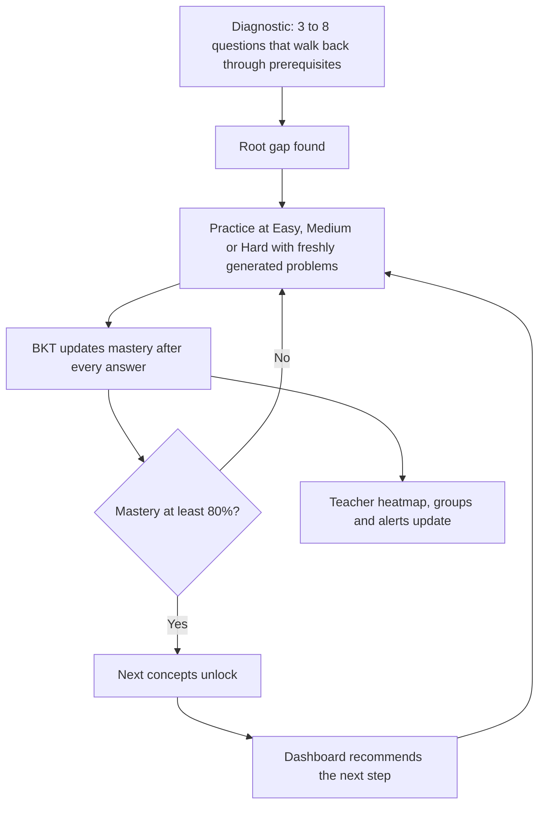

# Saarthi: adaptive learning for Classes 6 to 10

Saarthi finds the *root* gap behind a struggling learner, then adapts what to learn next, how, and how fast, while keeping the
teacher at the centre. This repository is a working full-stack prototype for Maths in Classes 6 to 10: a React web app, an Express
API with a mastery engine, a retrieval-grounded AI tutor that runs on a local Ollama model, teacher dashboards, contests, homework
with late penalties, a Class 6 to 10 exam centre, and English / Hindi / Telugu support. It deploys with one `docker compose` command.

> **Idea in one line:** every learner at their own pace, every teacher in control.

## Contents

1. [Architecture](#architecture)
2. [What it does](#what-it-does)
3. [How the main pieces work](#how-the-main-pieces-work)
4. [Tech stack](#tech-stack)
5. [Project structure](#project-structure)
6. [Run it locally](#run-it-locally)
7. [Deploy with Docker](#deploy-with-docker)
8. [Configuration](#configuration)
9. [API overview](#api-overview)
10. [Security and privacy](#security-and-privacy)
11. [Operations: updates, backups, data](#operations-updates-backups-data)
12. [Design system](#design-system)
13. [How it was built](#how-it-was-built)
14. [Known limits and next steps](#known-limits-and-next-steps)

---

## Architecture



**How a request flows.** The browser loads the built client from the same Express process that serves the API, so there is one
origin and no CORS in production. Every API call carries a bearer token. The auth gate resolves it to a user and a role, role
guards keep learners out of teacher routes, and the route handlers read and write one JSON database that lives on a persistent
volume. Only two things ever leave the app container: calls to the private Ollama container for the tutor.

### The tutor: retrieval-augmented answers



If Ollama is not running, the tutor falls back to answers extracted from the teacher-approved notes and says so, so the app never
breaks. A question that no approved note covers is flagged and logged so the teacher can add material for it.

### The learning loop



---

## What it does

### For learners

| Area | What you get |
|---|---|
| **Dashboard** | Mastery by concept, strand averages, weekly activity, badges, recent answers, homework due, next exam, and a year-long **activity heatmap** with streaks. |
| **Diagnostic** | Pick a topic you struggle with; the check walks back through its prerequisites to find the *root* gap, not just a low score, and gives an ordered path to fix it. |
| **Learning path** | The concept graph for your class. A concept unlocks when its prerequisites reach 50% mastery. |
| **Practice** | Every concept has **Easy / Medium / Hard** blocks. Problems are generated on the server with the answer computed, so they are always correct and never run out. A **rough work page** (draw with mouse, stylus or finger; scrolls inside itself) sits under each question. |
| **Tutor** | Ask any maths question. It solves step by step with a local Ollama model, cites the teacher's approved notes as numbered sources, and shows the retrieved passages next to the answer. **Chat history** is saved per learner and restored on return. Replies follow the chosen language. |
| **Homework** | Teacher-set homework with a deadline. Late work still counts for 3 days but loses points for every day (or part of a day) late. A banner always shows what lateness would cost. |
| **Contests and leaderboard** | One timed paper per week for the whole class (4 easy, 4 medium, 2 hard, 180 points, one attempt). Leaderboards rank by **contest points first, problems solved second**. |
| **Exam centre** | Exam countdowns, timed **mock papers** with section and topic analysis, a weekly **study plan** that tightens as the exam nears, an **exam-readiness** indicator, and a private **stress check-in** that alerts the teacher when someone is struggling. Available in every class. |
| **Study material** | Worksheets and notes the teacher approved for your class, downloadable. |
| **Messages** | A class group chat and a private chat with the teacher. |
| **Languages** | English, Hindi and Telugu, switchable anywhere. |

### For teachers

| Area | What you get |
|---|---|
| **Class selector** | Work one class at a time (6 to 10). Overview, students, homework, exams, resources, leaderboard and messages all follow it. |
| **Class overview** | Class average, learner groups (needs revision, on track, ready to advance), a concept-by-learner mastery heatmap, talking points for the topics most learners are weak in, unanswered tutor questions, and a class **activity heatmap**. |
| **Students** | Every learner's mastery, gaps, streak, contest rank, problems solved and last activity, with a detail panel (concept mastery, homework record, exam readiness, activity heatmap) and a one-click message. |
| **Alerts** | Learners silently falling behind, root gaps blocking later concepts, missing or overdue homework, and exam stress. |
| **Homework** | Assign homework by topic, difficulty, number of questions, points, deadline and late penalty; optionally attach an approved worksheet. Track who has handed in, on time, late or not at all, and post a reminder to the class chat. |
| **Resources** | **Add** worksheets, notes, talking points and parent summaries with an uploaded file (PDF, Word, image or text up to 3 MB), a link and/or a description. Approve, retire or delete. AI drafts reach learners only after approval. |
| **Exam preparation** | Set exam dates per class (unit, half-yearly, annual, pre-board, board), see each learner's readiness and who may need a kind word. |
| **Messages** | Chat with any learner personally or with a whole class group. |
| **Leaderboard and activity log** | Per-class leaderboards and a record of what learners and teachers did. |

### Across the platform

* **Classes 6 to 10 are separate spaces.** Concepts, practice, contests, homework, leaderboards, exams and group chats are all per class, and a learner can only reach their own class.
* **Role-based sign-in** with separate learner and teacher pages.
* **Multilingual** UI in English, Hindi and Telugu with proper fonts.
* **Responsive**: desktop, tablet and phone layouts.
* **Production-ready packaging**: one container serves everything, data survives updates, and there are backup and update scripts.

---

## How the main pieces work

**Mastery (Bayesian Knowledge Tracing).** Each learner has a probability of knowing each concept. After every answer it is updated from the answer's correctness using slip and guess rates, plus a small learning step. Below 40% is a *gap*, 80% or more is *mastered*, and a concept unlocks once its prerequisites reach 50%.

**Concept graph.** Twelve maths concepts with prerequisites form one shared pool. Each concept is tagged with the classes that study it (for example Class 6 has 5 concepts, Class 8 has 12, Class 10 has 9). Prerequisites outside a class are ignored for that class.

**Question generation.** `server/src/gen.js` computes every problem, its four options and its explanation from random parameters, so answers are correct by construction. A generator exists for each concept at each level. Contest, homework and mock papers are *seeded* by their id so everyone in a class gets identical questions without storing them. A check over 18,000 generated questions found no malformed or duplicate options.

**Diagnostic.** Starting at the chosen topic, the queue adds its prerequisites (breadth first, within the class). The root gaps are the wrong concepts whose own prerequisites were answered correctly.

**Contests and ranking.** Points are 10, 20 and 30 for easy, medium and hard. The leaderboard sorts by total contest points, then by total problems solved (practice, contest and homework), then by name. Within one contest, ties go to the faster time.

**Homework and the late rule.** `awarded = earned - min(earned, daysLate x penaltyPerDay)`, where `daysLate` counts every started day after the deadline. Late work is accepted until 3 days after the deadline; after that it closes and an unsent homework scores 0.

**Exam readiness.** An indicator, not a prediction: 50% topic mastery + 35% recent mock papers + 15% homework handed in (or 65% mastery + 35% homework before any mock paper). Bands: needs focus, getting there, on track, exam ready.

**Study plan.** Seven days built from the learner's weakest concepts: revise and practise days, a quick test and a full mock paper, and a rest day. Daily minutes grow as the nearest exam approaches (45, 60 or 90).

**Retrieval.** Notes are scored with BM25 over stemmed tokens, blended with cosine similarity from `nomic-embed-text` embeddings when available. Passages below a relevance threshold are not cited.

**Activity heatmap.** Each answer, contest, homework or mock paper adds to that day's count. The grid shows 53 weeks with level shading, hover details, total, active days, longest and current streak.

**Languages.** Strings are keyed by their English text, so any screen that is not yet translated stays readable in English. Translations live in `client/src/i18n`.

---

## Tech stack

| Layer | Technology |
|---|---|
| Client | React 18, Vite, Tailwind CSS, React Router, Axios, Context API, Recharts, react-hot-toast, lucide-react, Motion, Radix UI primitives |
| Server | Node 22, Express, scrypt password hashing, bearer-token sessions |
| AI | Ollama (`llama3.2` chat, `nomic-embed-text` embeddings), BM25 + embedding retrieval |
| Data | JSON file store with in-place upgrades (the PDF's PostgreSQL is the natural next step) |
| Delivery | Docker multi-stage build, Docker Compose, PowerShell backup and update scripts |
| Fonts | Inter, IBM Plex Mono, Noto Sans Devanagari and Telugu |

---

## Project structure

```
.
├── client/                     React app (Vite)
│   └── src/
│       ├── pages/              Learner and teacher screens
│       ├── components/         Shell, UI kit, tutor panels, heatmap, scratchpad
│       ├── context/            Session, class and unread state
│       ├── i18n/               Provider, language picker, hi.js, te.js
│       └── lib/                API client, data hook, helpers
├── server/
│   └── src/
│       ├── index.js            Routes: dashboard, diagnostic, practice, tutor, teacher
│       ├── engine.js           BKT, concept graph per class, recommendations
│       ├── gen.js              Question generators and seeded randomness
│       ├── seed.js             Concepts, notes, learners, resources, demo data
│       ├── auth.js crypto.js   Sign-in, sessions, scrypt hashing
│       ├── contests.js         Contests and leaderboards
│       ├── homework.js         Homework, late penalties, reminders
│       ├── exams.js            Exam dates, mock papers, study plan, readiness
│       ├── resources.js        Resource upload, approval, downloads
│       ├── messages.js         Class groups and personal chats
│       ├── retrieval.js llm.js Retrieval and Ollama client
│       └── store.js            JSON persistence and upgrades
├── scripts/                    backup.ps1, update.ps1
├── Dockerfile  docker-compose.yml  .env.example
└── README.md
```

---

## Run it locally

Requirements: Node 22 or newer. For the AI tutor, [Ollama](https://ollama.com).

```bash
npm run install:all     # installs root, server and client dependencies
npm run dev             # API on :4000, web on :5173 (proxies /api)
```

Open http://localhost:5173. The demo accounts and their passwords are defined in `server/src/seed.js` (`DEMO`) and are listed on the
sign-in page while `NODE_ENV` is not `production`. Learners sign in with their lower-case first name (for example `aarav`), the
teacher as `lakshmi`.

**Tutor models (optional but recommended):**

```bash
ollama pull llama3.2
ollama pull nomic-embed-text    # optional: semantic retrieval
```

Without Ollama the tutor still works from the approved notes and shows a notice.

Data is saved to `server/data/db.json`. Delete that file to return to the seed data.

---

## Deploy with Docker

```bash
cp .env.example .env            # then set real passwords in .env
docker compose up -d --build
```

Open http://localhost:8090 (change `APP_PORT` in `.env` if the port is taken). Compose starts three services:

| Service | Purpose |
|---|---|
| `app` | Express API plus the built client. Data and uploads live in the `saarthi-data` volume. |
| `ollama` | A private Ollama for the tutor; models are stored in the `ollama-models` volume. |
| `ollama-pull` | One-off job that downloads `llama3.2` and `nomic-embed-text` (about 2.3 GB). The tutor uses notes only until it finishes. |

In production the app refuses to start without `SAARTHI_TEACHER_PASSWORD` and `SAARTHI_STUDENT_PASSWORD`, and demo accounts are hidden.
On CPU-only machines AI answers take roughly 10 to 60 seconds; a GPU, a larger machine, or a hosted model API (swap `server/src/llm.js`) makes it faster.

To expose it beyond one computer, put it behind HTTPS (for example Caddy or nginx), set `TRUST_PROXY=1`, and open only that port.

---

## Configuration

| Variable | Default | Meaning |
|---|---|---|
| `SAARTHI_TEACHER_PASSWORD` | `teacher123` (dev only) | Teacher password. **Required** in production. |
| `SAARTHI_STUDENT_PASSWORD` | `student123` (dev only) | Password given to the seeded learners. **Required** in production. |
| `NODE_ENV` | | `production` hides demo accounts and requires the passwords above. |
| `PORT` | `4000` | API port inside the container or process. |
| `APP_PORT` | `8090` | Port published by Docker Compose. |
| `DATA_DIR` | `server/data` | Where `db.json` and uploads are kept. |
| `CLIENT_DIR` | `client/dist` | Built client served by the API. |
| `OLLAMA_HOST` | `http://localhost:11434` | Ollama address (Compose sets `http://ollama:11434`). |
| `OLLAMA_MODEL` | `llama3.2` | Chat model. |
| `OLLAMA_EMBED_MODEL` | `nomic-embed-text` | Embedding model. |
| `TRUST_PROXY` | unset | Set to `1` behind a reverse proxy so client IPs are correct. |
| `CORS_ORIGIN` | unset | Allow one other origin (development uses open CORS). |

Passwords are applied when the data is first created. Changing them later means resetting the data or updating the hashes.

---

## API overview

All routes are under `/api` and need `Authorization: Bearer <token>` except `GET /health`, `GET /auth/demo` (hidden in production) and `POST /auth/login`.

| Area | Routes |
|---|---|
| Auth | `POST /auth/login` `POST /auth/logout` `GET /auth/me` |
| Learner home | `GET /dashboard` `GET /concepts` `GET /activity` `GET /me` |
| Diagnostic and practice | `POST /diagnostic/start` `POST /diagnostic/answer` `GET /practice/next` `POST /practice/answer` |
| Tutor | `POST /chat` `GET /chats` `GET /chats/:id` `DELETE /chats/:id` `GET /llm/status` |
| Contests | `GET /contests` `POST /contests/:id/start` `POST /contests/:id/submit` `GET /contests/:id/me` `GET /leaderboard` `GET /leaderboard/:id` |
| Homework | `GET /homework` `GET /homework/:id` `GET /homework/summary` `POST /homework/:id/submit` |
| Exams | `GET /exams/centre` `POST /mock/start` `GET /mock/:id` `POST /mock/:id/submit` `POST /wellbeing` |
| Study material | `GET /study-material` `GET /files/:id` |
| Messages | `GET /messages/threads` `GET\|POST /messages/threads/:id` `GET /messages/unread` |
| Teacher (role `teacher`) | `GET /teacher/overview` `GET /teacher/students/:id` `GET /students` `GET\|POST /teacher/homework` `POST /teacher/homework/:id/remind` `GET\|POST /teacher/exams` `DELETE /teacher/exams/:id` `GET /teacher/exams/readiness` `GET /teacher/concepts` `GET\|POST /resources` `PATCH\|DELETE /resources/:id` `GET /events` |

Teacher routes accept `?grade=6..10` to pick the class.

---

## Security and privacy

* Passwords are hashed with **scrypt** and a per-user salt; sessions are random 256-bit tokens that expire after 7 days.
* Five wrong sign-in attempts lock a username for a minute.
* The server enforces roles and classes: learners cannot call teacher routes, and cannot open another class's contests, homework, chats or files.
* Uploads are limited to known file types and 3 MB, stored outside the web root, and downloadable only with sign-in (learners only for approved resources of their own class).
* Tutor chats and exam check-ins are private to the learner; the teacher sees only an alert and the readiness summary.
* Security headers are set, and `.env`, live data and backups are excluded from git and from the Docker image.

---

## Operations: updates, backups, data

```powershell
scripts\update.ps1     # backs up first, then rebuilds and restarts the app (data volume is kept)
scripts\backup.ps1     # saves the data volume to backups\saarthi-<timestamp>.tar.gz
```

* Data lives in the `saarthi-data` volume, so rebuilding never touches it.
* On start the server **upgrades saved data in place**: new collections and counters are added and nothing existing is overwritten. Unreadable data is left untouched on disk.
* Docker Desktop must be running on Windows for the site to be reachable; containers restart automatically after a reboot.

---

## Design system

A light, precise scientific-SaaS look: **Clinical Teal** (`#0F766E`) accents, **Deep Navy** (`#172D3B`) text, cool-white surfaces, thin borders, restrained motion and consistent components. Tokens are CSS variables in `client/src/index.css` and map to Tailwind in `client/tailwind.config.js`. The chat view pairs a conversation column with a persistent *Retrieved context* panel (compact source cards with retrieval scores) and numbered citation markers that highlight their source card. Amber is reserved for answers that fall outside approved material.

---

## How it was built

The project grew in stages, each one running and tested before the next:

1. **Foundation.** Design tokens, app shell (grouped sidebar, top bar, search palette), and an Express API with a seeded Class 8 concept graph, question bank and approved notes.
2. **Learning engine.** BKT mastery, prerequisite locking, recommendations, the diagnostic that finds root gaps, and the first learner dashboard and teacher overview.
3. **Tutor.** Retrieval over approved notes, an Ollama agent with citations, the source panel and citation rail, and the amber outside-the-notes card.
4. **Practice.** Easy / Medium / Hard blocks with generated problems and the scrollable rough work page.
5. **Competition.** Weekly contests, per-class leaderboards (contests first, problems solved second).
6. **Accounts and communication.** Separate learner and teacher sign-in, role-enforced API, the teacher Students view, class group chat and personal messages.
7. **Homework.** Teacher-set work with deadlines, a late penalty, reminders and alerts.
8. **Classes 6 to 10.** Separate spaces per class, then the exam centre (countdowns, mock papers, study plan, readiness, stress check-in) for every class.
9. **Languages.** English, Hindi and Telugu across the learner experience.
10. **Resources.** Teacher uploads and approvals, learner study material, the activity heatmap.
11. **Delivery.** Production mode, Docker Compose with Ollama, backup and update scripts, safe data upgrades, tutor chat history, and this repository.

---

## Known limits and next steps

* **Concept pool is shared.** Classes 6 to 10 reuse one tagged set of 12 concepts. Real per-class syllabi need new questions, notes and prerequisites.
* **Storage is a JSON file.** Fine for one instance and a class or two; move to PostgreSQL for several schools or multiple server copies.
* **No user-management screen.** Learners and the teacher come from the seed. An admin page for adding real accounts is the most important next feature.
* **Translation coverage.** Most learner screens are translated; the diagnostic, learning path, contest room and most teacher pages are English. Concept names, question explanations and chat text stay in English. Hindi and Telugu strings were machine-written and should be reviewed by native speakers.
* **Tutor quality.** `llama3.2` is small: it sometimes forgets to cite notes (the answer is then shown as outside the notes) and is slow without a GPU. A larger or hosted model improves both.
* **Offline use.** The PDF's offline-first, shared-phone and WhatsApp-summary ideas are not built yet; the UI only shows an offline badge.
* **Tests.** The server and generators were checked with ad-hoc scripts; there is no automated test suite yet.
